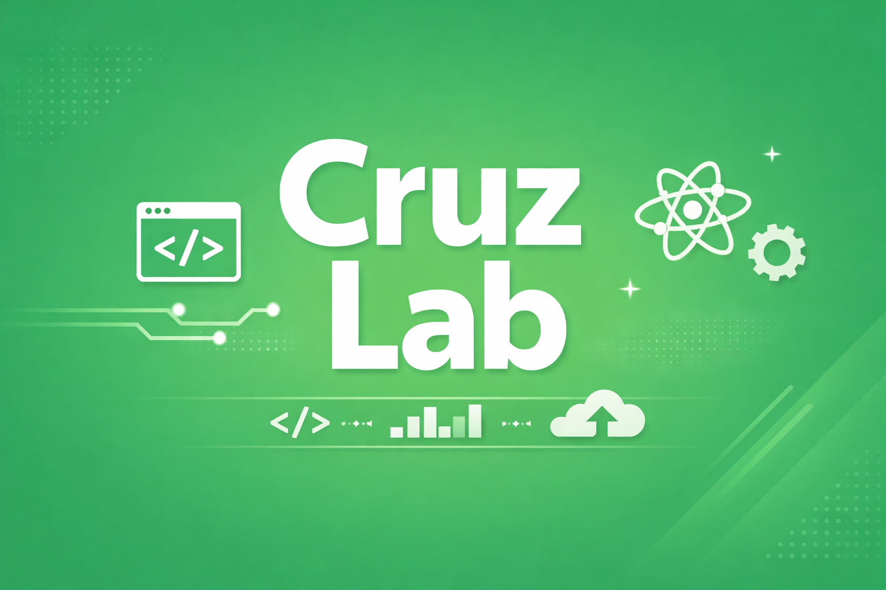

# Cruz Lab

브라우저에서 글을 쓰고, 이미지를 올리고, 바로 출간까지 확인할 수 있는 개인 기술 블로그 겸 포트폴리오 사이트입니다.

정적 블로그의 장점은 유지하되, 글을 올릴 때마다 로컬 파일 수정, 이미지 정리, 커밋, 배포 대기를 반복해야 하는 운영 병목을 줄이는 데 집중했습니다. 공개 페이지는 Astro로 가볍게 유지하고, 관리자 화면은 React 기반 CMS로 분리했습니다.

- Live: <https://cruzlab.dev>
- Project posts: <https://cruzlab.dev/projects/cruz-lab>
- GitHub: <https://github.com/crucial-sub/cruz-lab>



## 한눈에 보기

| 구분        | 내용                                                                                                                |
| ----------- | ------------------------------------------------------------------------------------------------------------------- |
| 문제        | 정적 블로그에서 글 작성, 이미지 업로드, 커밋, 배포 확인이 계속 끊겨 운영 부담이 컸습니다.                           |
| 해결        | 브라우저 CMS, Firebase Storage 업로드, Firestore direct publish, GitHub markdown 백업을 하나의 흐름으로 묶었습니다. |
| 공개 화면   | Astro 기반 블로그, 프로젝트, 시리즈 페이지로 콘텐츠 읽기 흐름을 구성했습니다.                                       |
| 관리자 화면 | 서버 렌더 최소 목록(`/admin`)과 Tiptap 3.33.0 에디터(`/admin/edit/[id]`)로 구성했습니다. 초안은 서버에 자동저장합니다. |
| 추가 실험   | 프로젝트 문서와 이력서를 로컬 read-only MCP 서버로 감싸 에이전트가 읽을 수 있는 문서 경계를 설계했습니다.           |

## 핵심 구현

| 영역             | 구현 내용                                                                                                | 관련 코드                                                                                                                               |
| ---------------- | -------------------------------------------------------------------------------------------------------- | --------------------------------------------------------------------------------------------------------------------------------------- |
| 에디터           | Tiptap 3.33.0 WYSIWYG, 마크다운 변환기(ProseMirror JSON ↔ markdown 왕복), 명령 레지스트리(단축키·슬래시 메뉴·명령 팔레트·툴바·모바일 바가 한 목록), 보기 모드 3종(편집·소스·미리보기), 서버 초안 자동저장(2초 디바운스, 버전 충돌 409 처리, 오프라인은 IndexedDB 보관함 1칸) | `src/editor/ui/EditorApp.tsx`, `src/editor/markdown/`, `src/editor/commands/registry.ts`, `src/editor/state/save-controller.ts`, `src/editor/state/offline-store.ts` |
| 이미지 업로드    | 드래그 앤 드롭/붙여넣기 이미지 처리, SHA-256 중복 검사, 서명 URL로 Firebase Storage 직접 업로드, 진행 상태 표시, 크기 선택(w480·w960·최대)   | `src/editor/upload/upload-client.ts`, `src/editor/upload/paste-drop.ts`, `src/editor/ui/ImageNodeView.tsx`                              |
| 마크다운 파이프라인 | remark·rehype 기반 `markdownToHtml`(GFM, KaTeX 수식, `> [!note]` 콜아웃, YouTube·CodeSandbox 임베드, 코드 하이라이트, 원시 HTML 안전 처리). 에디터 미리보기가 씁니다. 공개 페이지는 4단계에서 이 파이프라인으로 바꿉니다 | `src/lib/content/markdown.ts`, `src/lib/content/remark-callout.ts`, `src/lib/content/remark-embed.ts`, `src/lib/content/rehype-strip-unsafe.ts` |
| 출간 API         | 세션 쿠키 인증, 서버 초안과 버전 충돌 검사, 발행·숨김·삭제, CDN 캐시 태그 퍼지, 이미지 webp 변형          | `src/middleware.ts`, `src/lib/server/admin-entries.ts`, `src/lib/server/admin-assets.ts`, `src/pages/api/admin/posts/`                 |
| 공개 블로그      | Firestore `entries`의 발행본 조회, markdown 렌더링, 태그/검색/연재 페이지 구성                           | `src/lib/server/entries.ts`, `src/lib/content-posts.ts`, `src/pages/blog/index.astro`, `src/pages/blog/[...slug].astro`                |
| 접근성/읽기 경험 | skip link, `aria-current`, View Transitions, `prefers-reduced-motion`, 글 목록 검색·태그 필터                | `src/layouts/BaseLayout.astro`, `src/layouts/components/Header.astro`, `src/components/blog/BlogPostList.tsx`, `src/styles/global.css` |
| Knowledge MCP    | 허용된 markdown 문서만 읽는 로컬 stdio MCP 서버, tools/resources/prompts 분리                            | `tools/cruz-lab-knowledge-mcp/server.mjs`                                                                                               |

## 출간 흐름

재건 브랜치(`rebuild`)의 흐름이다. 자세한 순서는 [PUBLISHING.md](./PUBLISHING.md)에 있다.

| 단계 | 위치           | 처리 내용                                                                                 |
| ---- | -------------- | ----------------------------------------------------------------------------------------- |
| 1    | 미들웨어       | 관리자 경로에서 세션 쿠키를 검사하고, 쓰기 요청의 Origin을 확인합니다.                    |
| 2    | 초안 API       | 초안을 서버(Firestore `entries`)에 저장합니다. 버전 번호가 다르면 409로 덮어쓰기를 막습니다. |
| 3    | 자산 API       | 서명 URL로 Storage에 직접 올리고, 서버가 sharp로 webp 변형을 만듭니다.                    |
| 4    | 발행 API       | 발행 조건을 검사하고, 발행본·리비전·발행 기록을 한 트랜잭션으로 씁니다.                   |
| 5    | CDN            | 캐시 태그로 공개 페이지 캐시를 비웁니다.                                                  |
| 6    | 백업 저장소    | 비공개 저장소의 GitHub Action이 발행 직후와 매일 Firestore를 마크다운·JSON으로 남깁니다.  |

출간은 GitHub를 부르지 않습니다. 백업이 실패해도 발행은 성공합니다.

## 구조

| 영역          | 역할                                                                                                      |
| ------------- | --------------------------------------------------------------------------------------------------------- |
| Public pages  | Astro 기반 블로그, 프로젝트, 시리즈 페이지입니다. 발행 포스트는 Firestore에서 읽습니다.                   |
| Admin UI      | 서버 렌더 최소 목록 `/admin`(상태 탭, 새 글·새 노트 POST 폼)과 Tiptap 에디터 `/admin/edit/[id]`(React, `client:only`)입니다. 5단계에서 React 관리자 앱으로 다시 만듭니다. |
| Astro API     | 세션 인증, 초안 저장, 발행·숨김·삭제, 이미지 업로드·변형·정리를 처리합니다.                               |
| Firebase      | Auth는 관리자 확인에, Firestore는 글(`entries`)과 자산 기록 저장에, Storage는 이미지/영상 저장에 사용합니다. |
| GitHub backup | 비공개 저장소의 GitHub Action이 모든 글을 마크다운과 JSON으로 남깁니다.                                   |
| Knowledge MCP | 허용된 프로젝트 문서, 기술 글 초안, 이력서 문서를 read-only stdio MCP 서버로 제공합니다.                  |

## 주요 설계 선택

### Firestore를 공개 데이터 기준으로 사용

기존 markdown 파일만으로 운영하면 커밋과 배포가 끝날 때까지 공개 반영을 기다려야 했습니다. Cruz Lab은 공개 블로그가 Firestore를 직접 읽게 만들고, markdown은 GitHub 백업으로 남기는 구조를 사용합니다.

### Astro와 React 역할 분리

공개 페이지는 콘텐츠를 읽는 화면이므로 Astro 페이지와 서버 라우트 중심으로 구성했습니다. 반대로 에디터는 편집 상태, 자동저장, 업로드 진행처럼 상태 변화가 많아 React island(`client:only`)로 분리했습니다. 관리자 목록은 서버 렌더입니다.

### MCP 서버는 작게 제한

`cruz-lab-knowledge-mcp`는 검색 제품이 아니라 문서 경계 실험입니다. 이 저장소의 `src/content/projects`와 저장소 밖 `career` 폴더의 `writing/final-posts`, `resume`만 읽고, PDF, 이미지, Firebase admin key, 빌드 산출물, `node_modules`는 제외합니다. `career` 폴더의 위치는 환경 변수 `CRUZ_LAB_CAREER_ROOT`로 정하고, 기본값은 저장소 옆의 `../career`입니다. `read_doc`은 절대 경로와 허용 루트 밖 path traversal을 거부합니다.

## 기술 스택

| 영역                 | 사용 기술                                                      |
| -------------------- | -------------------------------------------------------------- |
| Framework            | Astro 5, React 19                                              |
| Language             | TypeScript                                                     |
| Styling              | Tailwind CSS, Framer Motion                                    |
| Editor               | Tiptap 3.33.0 (ProseMirror), lowlight, KaTeX                   |
| Content              | Markdown(unified remark·rehype)/MDX, Astro Content Collections, Firestore |
| Auth / Data / Assets | Firebase Auth, Firestore, Firebase Storage, Firebase Admin SDK |
| Deploy               | Vercel adapter                                                 |
| MCP                  | `@modelcontextprotocol/sdk`, Node.js stdio server              |

## 디렉터리 구조

```text
src/
  pages/
    blog/                 # 공개 블로그 페이지
    admin/                # 관리자: 최소 목록(index), 에디터(edit/[id]), 로그인, 옛 주소 301
    api/admin/            # 세션, 초안 저장·발행·숨김·삭제, 자산 업로드·변형·정리 API
    projects/             # 프로젝트 상세 페이지
    series/               # 시리즈 페이지
  editor/                 # Tiptap 에디터 패키지
    commands/             # 명령 레지스트리, 키맵, 슬래시 메뉴, 명령 팔레트
    extensions/           # 스키마(콜아웃·임베드·수식 포함), 입력 규칙
    markdown/             # ProseMirror JSON ↔ markdown 변환기
    state/                # 저장 컨트롤러, 자동저장 상태, 오프라인 보관함
    ui/                   # EditorApp, 툴바, 모바일 바, 노드 뷰, 대화상자
    upload/               # 이미지 업로드 클라이언트, 드롭·붙여넣기
  components/
    admin/                # 관리자 로그인
    blog/                 # 글 목록, 본문 렌더
    islands/              # 공개 페이지 React island UI
  layouts/                # BaseLayout(공개), AdminPage(관리자)
  lib/
    content/              # 공유 마크다운 파이프라인(markdown.ts), 콜아웃·임베드 플러그인
    server/               # Firestore, Firebase Admin, 세션, CDN 퍼지, 백업 알림 서버 유틸
  content/projects/       # 프로젝트 메타 문서와 프로젝트 포스트

scripts/
  smoke/                  # API, 공개 페이지, 마크다운 왕복 검사
  migrate/                # 2단계 마이그레이션과 되돌리기
  ops/                    # 버킷 CORS

tools/
  cruz-lab-knowledge-mcp/ # read-only MCP 서버

data/
  post-archive/           # 옛 CMS 출간 markdown 사본
```

## 로컬 실행

```bash
pnpm install
pnpm dev
```

```bash
pnpm build
pnpm preview
pnpm lint
pnpm test
pnpm mcp:knowledge
```

## 환경 변수

`.env.example`을 기준으로 `.env`를 만듭니다.

클라이언트와 관리자 로그인:

```bash
PUBLIC_FIREBASE_API_KEY=
PUBLIC_FIREBASE_AUTH_DOMAIN=
PUBLIC_FIREBASE_PROJECT_ID=
PUBLIC_FIREBASE_STORAGE_BUCKET=
PUBLIC_FIREBASE_MESSAGING_SENDER_ID=
PUBLIC_FIREBASE_APP_ID=
PUBLIC_ADMIN_EMAIL=
PUBLIC_SITE_URL=
```

서버 출간과 백업:

```bash
GITHUB_TOKEN=
FIREBASE_ADMIN_PROJECT_ID=
FIREBASE_ADMIN_CLIENT_EMAIL=
FIREBASE_ADMIN_PRIVATE_KEY=
```

`FIREBASE_ADMIN_PROJECT_ID`는 비워두면 `PUBLIC_FIREBASE_PROJECT_ID`를 fallback으로 씁니다. `FIREBASE_ADMIN_PRIVATE_KEY`는 줄바꿈을 `\n` 형태로 넣어도 서버에서 복원합니다.

## 범위

이 프로젝트는 범용 CMS나 다중 사용자 SaaS가 아닙니다. 개인 블로그를 실제로 운영하기 위한 크기로 잘랐습니다.

- 권한 모델은 `PUBLIC_ADMIN_EMAIL`로 지정한 단일 관리자 기준입니다.
- Firestore와 GitHub 사이에 완전한 분산 트랜잭션을 만들지는 않았습니다. 대신 실패 시 GitHub 백업을 정리하는 보상 흐름을 둡니다.
- MCP 서버는 read-only 로컬 stdio 서버입니다. 벡터 검색, 임베딩, 원격 배포, 인증은 넣지 않았습니다.
- PWA와 오프라인 캐시는 두지 않았습니다. 서비스워커의 페이지 이동 규칙이 SSR 구조와 맞지 않아 걷어냈습니다.
